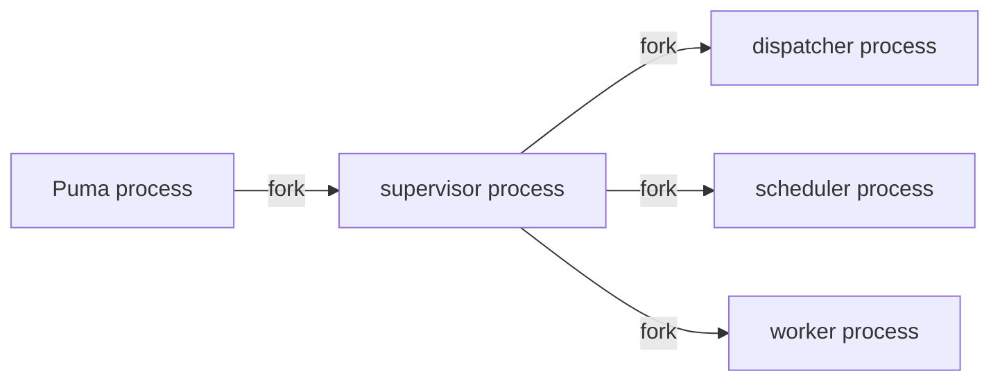
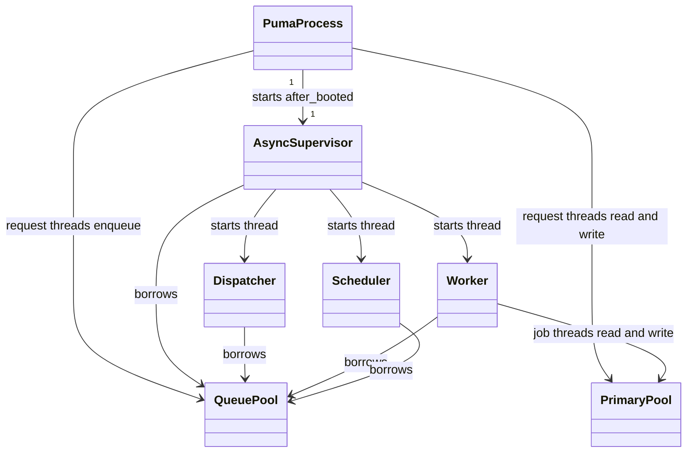
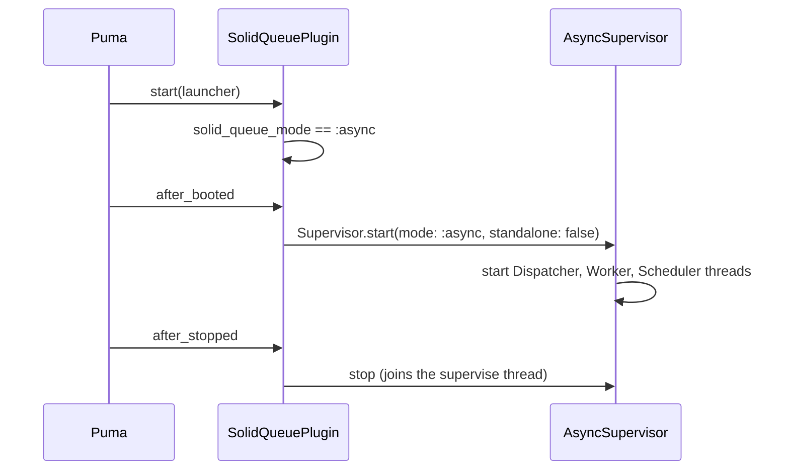

# Plan: Run Solid Queue in async mode inside Puma

From `intent.md` (2026-10-26). Status: accepted (2026-10-26).

## Design

### Domain terms

- **Fork mode**: the Solid Queue supervisor forks a child process each for the dispatcher, the scheduler and the worker. This is the current production setup.
- **Async mode**: the supervisor, dispatcher, scheduler and worker run as threads inside the Puma process (`solid_queue_mode :async`).
- **Queue database pool**: the most connections the `queue` database lets one process hold at once (`max_connections` in `config/database.yml`).

No glossary exists yet. Etienne chose to add no terms to one in this change.

### Diagrams

Before (fork mode):



After (async mode):





### Signatures

No Ruby class changes. The change uses one Puma DSL method that solid_queue 1.7.0 defines in `lib/puma/plugin/solid_queue.rb`:

```ruby
# Puma DSL; exists only after `plugin :solid_queue` has loaded the plugin file.
#: (?Symbol | String mode) -> Symbol
def solid_queue_mode(mode = :fork)
```

Not checked: the project has no Steepfile and no `sig/` directory, and this change adds no Ruby methods.

### Complexity

- No new query path. Polling, heartbeats and job queries stay the same as in fork mode. They now come from one process instead of four.
- Queue database pool worst case is 19 connections, plus 1 spare, so 20. The count does not grow with users or jobs:

  | Owner | Threads that can hold a queue connection | Count |
  |---|---|---|
  | Puma | request threads that enqueue (`RAILS_MAX_THREADS` unset, so 3) | 3 |
  | Supervisor | supervise loop, heartbeat timer, maintenance timer | 3 |
  | Dispatcher | poll loop, heartbeat timer, concurrency/batch maintenance timer | 3 |
  | Worker | poll loop, heartbeat timer, 3 job threads (`threads: 3`) | 5 |
  | Scheduler | run loop, heartbeat timer, 3 recurring task timers (ReminderJob and SessionExpiryJob both fire at 00:00) | 5 |
  | Spare | | 1 |
  | **Total** | | **20** |

- Primary database pool worst case is 6: 3 Puma request threads and 3 job threads. The plan sets 10 to give headroom.
- SQLite opens connections lazily, so a larger `max_connections` costs nothing until it is used.

### Invariants

- With `SOLID_QUEUE_IN_PUMA` set, no `solid-queue-*` process exists. This holds because `solid_queue_mode :async` makes the plugin call `start_async` instead of `fork`. Checked with `ps`.
- Without `SOLID_QUEUE_IN_PUMA`, Puma boots with no Solid Queue and no `NoMethodError`. This holds because one `if` block guards both `plugin :solid_queue` and `solid_queue_mode :async`. The test suite and a plain development `bin/rails server` boot prove it.
- The production queue database pool is at least 20, and the production primary pool is at least 10. `config/database.yml` enforces both. A `bin/rails runner` check reads both values. The gem's own pool warning sizes one forked worker only (3 + 2 = 5), so it cannot guard async mode. The count comment in `database.yml` is the guard for later edits.
- The change holds no migration and no schema, data or `config/deploy.yml` change. This keeps `kamal rollback` to the previous image safe. The diff review enforces it.

### Alternatives

- **A: least change (chosen).** One `if` block in `config/puma.rb`, plus literal `max_connections` values with a count comment in `config/database.yml`. No new code.
- **B: derived pool object (rejected).** A `QueueDatabasePool` class in `config/` would compute the size from Puma threads, `queue.yml` and `recurring.yml`. `database.yml` would `require` it through ERB. It is wider than the intent, unusual in `database.yml`, and it still copies Solid Queue 1.7's thread model as constants, so a gem upgrade can still make it stale.
- **C: environment-variable mode switch (rejected).** `solid_queue_mode ENV.fetch("SOLID_QUEUE_MODE", "async")`. A rollback still needs a `deploy.yml` edit and a Kamal command. It departs from the intent's exact line and edges into fork-mode scope. `kamal rollback` to the previous image is cheaper.

## Design decisions

- **Guard both lines in one `if` block.** `solid_queue_mode` exists only after `plugin :solid_queue` loads the plugin file. A bare second line raises `NoMethodError` in development and test. The block keeps `solid_queue_mode :async` on the line after `plugin :solid_queue`, as the intent says.
- **Scope addition: raise the production primary pool to 10.** The intent names only the queue pool. In async mode the 3 job threads share the primary pool with the 3 Puma threads (6 > 5). Etienne agreed to the addition at the design gate. Cache and cable stay at 5.
- **Development stays as it is.** Cause of "Detected Solid Queue has gone away" in development: development sets no `solid_queue.connects_to` and has no queue database. So `SolidQueue::Record` uses the primary development database, which has no `solid_queue_*` tables. The forked supervisor raises `no such table` during boot and exits. The plugin's monitor then logs the message and stops Puma. The production change does not need development to run Solid Queue, so the intent's out-of-scope line holds.
- **Verify locally in the production environment.** Use `RAILS_ENV=production SECRET_KEY_BASE_DUMMY=1`. The worktree has no `config/master.key`, and the Dockerfile uses the same dummy secret. `recurring.yml` defines tasks only under `production:`, so only this environment can prove the scheduler criterion. Local production databases land in `storage/`, which git ignores.
- **No tests.** This is a configuration change (playbook rule 3). Each Proof line names a check. Evidence goes to `docs/changes/solid-queue-async-in-puma/verification.md`.
- No conflict with intent's `## Decisions`: async mode inside Puma is used, and `config/deploy.yml` stays the same.

## Integration points

- solid_queue 1.7.0 Puma plugin (`lib/puma/plugin/solid_queue.rb`) and `SolidQueue::AsyncSupervisor`.
- Puma 8.0.2 (`after_booted`, `after_stopped`, `before_restart` events).
- Production host CT104 through Kamal. `config/deploy.yml` already sets `SOLID_QUEUE_IN_PUMA: true`. Etienne deploys himself.
- Jobs: `ReminderJob`, `Appkit::SessionExpiryJob`, and the hourly `clear_solid_queue_finished_jobs` command, all from `config/recurring.yml`.

## Files that change

- `config/puma.rb`: replace `plugin :solid_queue if ENV["SOLID_QUEUE_IN_PUMA"]` with an `if ENV["SOLID_QUEUE_IN_PUMA"]` block that holds `plugin :solid_queue` and then `solid_queue_mode :async`. Update the comment above it to say Solid Queue runs as threads inside Puma.
- `config/database.yml`: under `production.queue`, add `max_connections: 20` with a comment that counts the threads (as in the Complexity table). Under `production.primary`, add `max_connections: 10` with a comment: 3 Puma threads and 3 Solid Queue job threads, plus headroom.
- `docs/changes/solid-queue-async-in-puma/verification.md` (new): the commands run and their output.

## Order of work

No acceptance criterion needs a test, so the work starts with the evidence and the change, and the checks follow.

1. Reproduce the development failure before any change. Run `SOLID_QUEUE_IN_PUMA=true bin/rails server -p 3001` in development, wait for the exit, and record the `no such table` error and the "Detected Solid Queue has gone away" line in `verification.md`. Stop the server.
2. Edit `config/puma.rb` as in Files that change. Run `bin/rubocop config/puma.rb`.
3. Edit `config/database.yml` as in Files that change.
4. Run `RAILS_ENV=production SECRET_KEY_BASE_DUMMY=1 bin/rails db:prepare` to create the local production databases.
5. Start `RAILS_ENV=production SECRET_KEY_BASE_DUMMY=1 SOLID_QUEUE_IN_PUMA=true bin/rails server -p 3000` in the background. Then run each check under `## Proof` and record the output in `verification.md`.
6. Wait for the next quarter hour (:00, :15, :30, :45) and run the ReminderJob check.
7. Stop the server. Confirm in its log that Solid Queue stopped with Puma, and that the log has no "needs at least ... database connections" warning.
8. Boot development without the variable (`bin/rails server -p 3001`). Confirm that it starts with no `NoMethodError`, then stop it.
9. Run the full test suite and every linter.
10. Re-read the diff. Every hunk must be required. Commit `config/puma.rb` and `config/database.yml` as one commit, and `verification.md` as another.

## Risks

- **Isolation is lost.** A crashing or long-running job thread now shares the Puma process. On shutdown timeout, `AsyncSupervisor#perform_immediate_termination` calls `exit!`, and that takes Puma down too. Etienne accepted this in the intent.
- **The pool numbers are hand-counted literals.** They go stale when someone changes `RAILS_MAX_THREADS`, worker `threads`, or the number of recurring tasks. The comment in `database.yml` is the only guard. Design B, which derives the numbers, was rejected.
- **The count copies Solid Queue 1.7's thread model.** A gem upgrade can change it. Re-check the count on each solid_queue upgrade.
- **SQLite allows one writer at a time.** The writers now come from one process instead of four, with WAL and `timeout: 5000` as before. Contention does not change.
- **Rollback.** `kamal rollback <previous version>` (Etienne only) brings back fork mode, because the change holds no schema or `deploy.yml` change. That works for the next 5 deploys while Kamal keeps the old container. After that, the route back is a git revert.
- **The local production boot is not CT104.** Local verification proves the process model, the scheduler and job execution. It does not prove the memory saving on CT104. Etienne measures that after he deploys.

Out of scope: `config/deploy.yml`, fork mode, Puma worker and thread counts, other memory tuning, cache and cable pools, any job, `config/recurring.yml` or `config/queue.yml` content, running Solid Queue in development, a glossary file, and deploying.

## Proof

Every check runs in the worktree with the local production server from step 5 running. `PROD` stands for `RAILS_ENV=production SECRET_KEY_BASE_DUMMY=1`.

- Booted with `SOLID_QUEUE_IN_PUMA=true`, `ps` shows one Ruby process for Puma and no solid-queue process → check: `ps -o pid,ppid,command -ax | grep -E 'puma|solid-queue' | grep -v grep` shows one Puma line and no `solid-queue-supervisor`, `-dispatcher`, `-scheduler` or `-worker` line. Then `PROD bin/rails runner 'p SolidQueue::Process.pluck(:kind, :pid)'` lists `Supervisor(async)`, `Dispatcher`, `Worker` and `Scheduler`, all with the Puma pid.
- An enqueued job runs to completion → check: `PROD bin/rails runner 'Appkit::SessionExpiryJob.perform_later'`, then after a few seconds `PROD bin/rails runner 'p SolidQueue::Job.where(class_name: "Appkit::SessionExpiryJob").last.finished_at'` prints a time, not `nil`.
- The scheduler loads the recurring tasks and enqueues `ReminderJob`, and `Appkit::SessionExpiryJob` is among the loaded tasks → check: `PROD bin/rails runner 'p SolidQueue::RecurringTask.pluck(:key, :class_name)'` lists `clear_solid_queue_finished_jobs`, `mood_reminders` (`ReminderJob`) and `appkit_session_expiry` (`Appkit::SessionExpiryJob`). After the next quarter hour, `PROD bin/rails runner 'p SolidQueue::Job.where(class_name: "ReminderJob").pluck(:finished_at)'` shows at least one finished job.
- `/up` returns 200 → check: `curl -s -o /dev/null -w '%{http_code}' http://localhost:3000/up` prints `200`.
- The queue database pool covers all Solid Queue threads plus the Puma threads that enqueue jobs → check: `bin/rails runner 'c = ActiveRecord::Base.configurations; p %w[queue primary].to_h { |n| [n, c.configs_for(env_name: "production", name: n).configuration_hash[:max_connections]] }'` prints `{"queue" => 20, "primary" => 10}`. 20 covers the 19 threads counted in Complexity. The server log has no "Solid Queue needs at least" warning.
- The full test suite and every linter are green → check: `bin/rails test`, `npm test`, `bin/rubocop`, `npx eslint .`, `npm run stylelint` and `bundle exec herb lint` all exit 0.
- Invariant: without `SOLID_QUEUE_IN_PUMA`, Puma boots with no Solid Queue and no `NoMethodError`, enforced by the `if` block in `config/puma.rb` → check: step 8's development boot, and the green test suite.
- Invariant: no `solid-queue-*` process exists in async mode, enforced by `solid_queue_mode :async` → check: the `ps` check above.
- Development failure cause → check: step 1's log, recorded in `verification.md`.

Per changed file, the unit tests expected: none. `config/puma.rb` and `config/database.yml` are configuration (playbook rule 3).

Test setup: none. Local production SQLite files go in git-ignored `storage/`. They need no master key, because `SECRET_KEY_BASE_DUMMY=1` stands in for the secret key base.

---
Domain skills applied: rails-ops (single-host Solid Queue process model), rails-architecture (no new objects), software-design (alternatives and invariants), diagrams.
